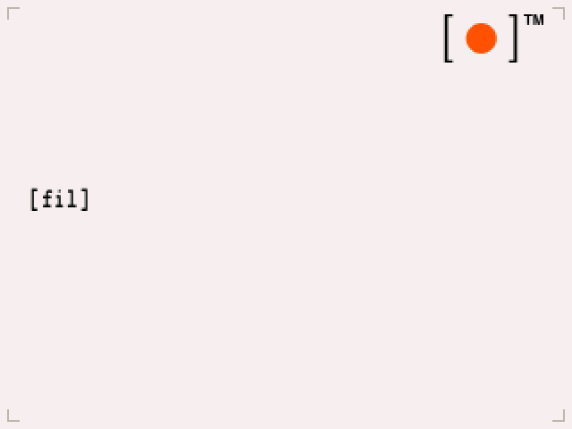
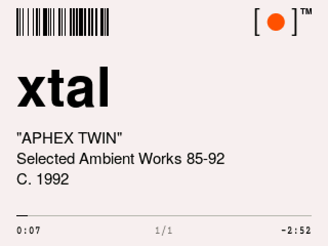
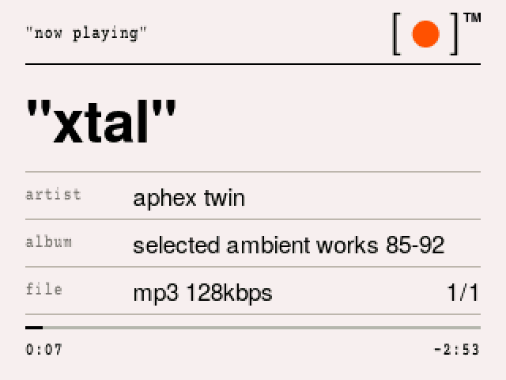
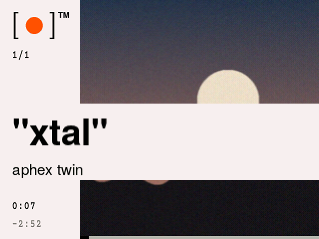
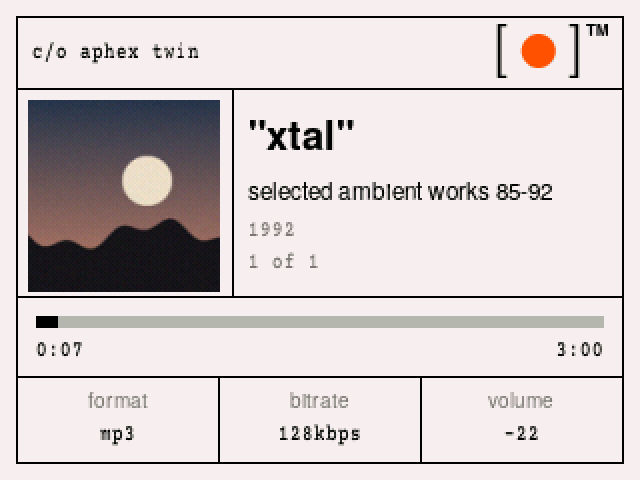

# papel

`[●]™` "papél" c/o jorge cuza: a Rockbox theme for the **iPod Video (5G / 5.5G, 320×240)**.

It has off-white menus with one `[item]` per screen, a big-type player with a real barcode, an off-white boot screen, and a QR code plug-in screen. Built from the [**papél**](https://github.com/jorgecuza92/papel-ui-library) brand library.

| menu | player | plug-in (USB) | boot |
|---|---|---|---|
|  |  |  |  |

## "two editions"

| | `theme/` + `firmware/` (full) | `theme-stock/` |
|---|---|---|
| runs on | the papél build of Rockbox 4.0 (included) | standard Rockbox 4.0 |
| song title | lowercase | as tagged |
| artist | `"ALL CAPS"` | `"As Tagged"` |
| long album | wraps to a 2nd line, hyphenated if needed | scrolls on one line |
| year | `C. 1992`, from any date format | `C. ` + the first 4 characters of the tag |
| boot screen | `[●]™` on off-white | Rockbox logo |
| plug-in screen | QR code reading "eject safely" | Rockbox USB logo |
| reel/peak refresh | 25 fps | 5 fps |

Menus, fonts, colours, brackets, the barcode and the mark are the same in both editions.

## "install" (full edition)

You need an iPod Video already running Rockbox 4.0. If yours doesn't yet, install it with [Rockbox Utility](https://www.rockbox.org/download/) first.

1. **Download** this repo: green **Code** button, then **Download ZIP**. Unzip it on your computer.
2. **Plug in** the iPod. It shows up as a drive (on a Mac it's usually called `IPOD`).
3. **Show hidden files.** The `.rockbox` folder is hidden. On a Mac, press `Cmd + Shift + .` in Finder. On Windows, open View, then tick "Hidden items".
4. **Firmware:** unzip `firmware/rockbox-papel-ipodvideo.zip` onto the **root** of the iPod drive, replacing files when asked. This swaps in the papél build of Rockbox (your settings and music aren't touched).
5. **Theme:** copy everything inside `theme/.rockbox/` into the iPod's `.rockbox/` folder, merging folders.
6. **Eject** the iPod, unplug it, and restart it: hold **Menu + Select** until it reboots.
7. On the iPod go to **Settings, then Theme Settings, then Browse Theme Files**, and pick **papel**. With the papél language active, that menu reads `set`, then `theme_set`, then `brws_theme_files`.

Standard Rockbox: skip step 4 and copy `theme-stock/.rockbox/` in step 5.

> **Note:** `theme/.rockbox/tagnavi_user.config` relabels the database menu (`alb_artist`, `fav_alb`…). Leave it out if you already have your own.

To go back to plain Rockbox, reinstall it with Rockbox Utility. Your music and settings stay.

## "build it yourself"

The firmware is Rockbox at commit `e094c599fa` (v4.0 branch) plus [`patches/papel-rockbox-v4.0.patch`](patches/papel-rockbox-v4.0.patch):

```sh
git clone https://github.com/Rockbox/rockbox.git && cd rockbox   # or git.rockbox.org
git checkout e094c599fa60236527f9e272e0b8309d7696e399
git apply --binary ../papel/patches/papel-rockbox-v4.0.patch
mkdir build && cd build && ../tools/configure     # target: ipodvideo, normal build
make -j8 && make zip                               # -> rockbox.zip
```

What the patch adds:

| change | file | what |
|---|---|---|
| `%ss(...,lower\|upper)` | `skin_tokens.c`, `skin_parser.c` | change the case of any skin text (ASCII + Latin-1) |
| `%ss(...,wrap1\|wrap2)` | same | split text across two lines, measured with the line's font: break at a space, or hyphenate when line 1 would be short |
| `%ss(...,year)` | same | the first 4-digit run (`09-22-1992` becomes `1992`) |
| `%ss(...,askew)` | same | caps with uneven letter spacing (needs a `convttf -J` font) |
| `%LB(...,dots)` | `skin_display.c` | list position as one dot per item |
| 25 fps | `peakmeter.h`, `wps.c`, `skin_render.c` | smoother redraws, `%t(x.yz)` hundredths, smooth seeking |
| full-screen boot logo | `main.c`, `bitmaps/native` | `[●]™` on paper, no version line |
| full-screen USB logo | `usb_screen.c`, `SOURCES` | the QR screen. Also skips the keypad-mode line when the logo fills the screen; drawing it off-screen used to crash. |
| `convttf -A -J -k` | `tools/convttf.c` | true advance widths, spacer glyphs, outline thinning |
| `RB_KEYS` | `button-sdl.c` | scripted key presses for the simulator (screenshots) |

`tools/` has the scripts that made the assets: `make_lang.py` (lowercase, abbreviated, underscored menu language: `--case lower --short --underscore`), `make_paper.py` (the players), `condense.py` (the condensed Courier), `fntview.py` (preview .fnt files) and `package_papel_rockbox.py` (assembles this repo).

## "credit"

Use it, change it, share it. Just give credit:

> design: "papél" c/o Jorge Cuza: github.com/jorgecuza92/papel

- Theme (skins, images, language and theme files): [CC BY 4.0](LICENSE).
- Firmware and patch: GPL v2 or later, like Rockbox ([COPYING](COPYING)).
- Tools: MIT ([LICENSE-CODE](LICENSE-CODE)).
- Fonts (bitmap .fnt files):
  - TeX Gyre Heros: GUST Font License.
  - Courier Prime Papel, from Courier Prime: SIL OFL 1.1.
  - Licence texts are in `fonts-licenses/`.

Rockbox is © The Rockbox Team ([rockbox.org](https://www.rockbox.org)). Inspired by the catalogue and wall-text language of Virgil Abloh. papél is an independent personal project, not affiliated with him, his estate, Rockbox or Apple.

## "alternate players"

Pick these in the theme list (`papel-sheet`, `papel-art`, `papel-label`).

<p>



</p>
